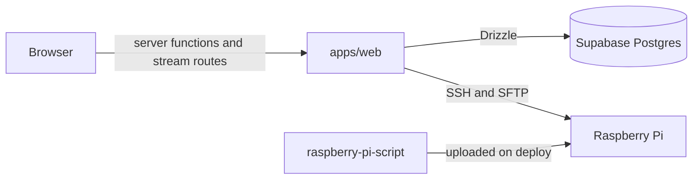

# Remote Raspberry Pi web control center

A web app to manage the Raspberry Pis on your network. Write a Node.js program in [`raspberry-pi-script/`](raspberry-pi-script), then from your browser:

- **Find** your Pis on the local network: by name (`raspberrypi.local`), by their Raspberry Pi network card, and by an open SSH port
- **Deploy** it to any of your Pis with one click: upload over SFTP, `npm install`, start in the background
- **Start, stop and restart** it, and see whether it is running
- **Watch its output live** while it runs
- **Check the Pi's health**: online status, CPU temperature, memory, load and uptime
- **Switch GPIO pins** high or low (the example script blinks an LED on GPIO 6)
- **Open a terminal** on the Pi: an interactive SSH login shell in the browser, using the saved login
- **Browse past deploys** and their full output, plus an activity log of everything that happened

## How it works

The web app is the only thing that talks to the Pis. It opens an SSH connection for each request, using the login you saved for that device. The Pi only needs SSH and Node.js; nothing extra runs on it.



On the Pi, a deploy goes like this:

1. Stop the running script, if any, then empty `~/<deploy folder>` (default `~/raspberry-pi-script`).
2. Upload every file from `raspberry-pi-script/` except `node_modules`.
3. Run `npm install`.
4. Start `npm run start` detached from the SSH session (`setsid nohup`). Its process id goes to `app.pid` and its output to `app.log` in the deploy folder.

**Stop** sends `SIGTERM` to the script's whole process group, waiting up to 5 seconds before it uses `SIGKILL`. The **Output** tab follows `app.log` with `tail -F`. **GPIO** uses `pinctrl` (Raspberry Pi OS Bookworm), or `raspi-gpio` on older releases.

## Quick start

### Prerequisites

- [Bun](https://bun.sh) 1.2 or newer and Node.js 20 or newer
- [Docker Desktop](https://www.docker.com/products/docker-desktop/) running (for the local Supabase stack: Postgres, auth and email)

### Run it

```bash
bun install
bun run dev
```

`bun run dev` creates any missing `.env` files, starts Supabase, copies its keys into the `.env` files, applies the database migrations and starts the web app.

1. Open <http://127.0.0.1:3000> and sign in with any email address.
2. The sign-in email lands in the local inbox at <http://127.0.0.1:54724>. Use the code or the link in it.
3. Open **Find a Pi** to scan your network, and press **Add device** next to your Pi. Or, on **Devices**, press **Add device** and enter the Pi's host name (e.g. `raspberrypi.local`), the SSH user, and its password or private key. Then press **Test connection**.
4. Open the device and press **Deploy**.

Set `DEVICE_SECRET_KEY` in `apps/web/.env` before you add a device (see [Environment variables](#environment-variables)).

## Setting up the Raspberry Pi

1. Flash Raspberry Pi OS with [Raspberry Pi Imager](https://www.raspberrypi.com/software/). In its settings, set the Wi-Fi, a user and password, and **enable SSH**.
2. Check that you can connect: `ssh pi@raspberrypi.local`

### Install Node.js on the Pi

```bash
# update the system package list
sudo apt update
sudo apt upgrade
# install the packages needed to add the NodeSource repository
sudo apt install -y ca-certificates curl gnupg
# add the NodeSource signing key
curl -fsSL https://deb.nodesource.com/gpgkey/nodesource-repo.gpg.key | sudo gpg --dearmor -o /usr/share/keyrings/nodesource.gpg
# pick the Node.js major version
NODE_MAJOR=22
# add the Node.js repository to the sources list
echo "deb [signed-by=/usr/share/keyrings/nodesource.gpg] https://deb.nodesource.com/node_$NODE_MAJOR.x nodistro main" | sudo tee /etc/apt/sources.list.d/nodesource.list
# install Node.js
sudo apt update
sudo apt install nodejs
# check that it worked
node -v
```

Node.js installed through `nvm` works too; the control center loads `~/.nvm/nvm.sh` when it exists.

### GPIO access

The SSH user must be in the `gpio` group, so that the script (with `onoff`) and the GPIO tab (with `pinctrl`) can use the pins without `sudo`. The default user created by Raspberry Pi Imager already is. Otherwise run `sudo usermod -aG gpio <user>` and log in again.

## Writing your script

[`raspberry-pi-script/`](raspberry-pi-script) is a plain Node.js project and is uploaded as it is:

- `npm run start` is what runs on the Pi. The example uses `tsx src/index.ts`, so you can write TypeScript.
- Anything it prints shows up on the device's **Output** tab.
- Handle `SIGTERM` to clean up (unexport pins, close files) when you press **Stop**, **Restart** or **Deploy**.
- It is kept out of the Bun workspaces, because `onoff` only installs on Linux. Its dependencies are installed on the Pi.

To deploy a different folder, set `RASPBERRY_PI_SCRIPT_DIR` (see below).

## Environment variables

`apps/web/.env` is created from [`apps/web/.env.example`](apps/web/.env.example) on the first `bun run dev`. `bun run env:sync` fills in the Supabase keys.

| Variable | Meaning |
| --- | --- |
| `DEVICE_SECRET_KEY` | **Required.** Encrypts device passwords and private keys in the database (AES-256-GCM). Any long random string, e.g. `openssl rand -base64 32`. If you change it, re-enter the device logins. |
| `RASPBERRY_PI_SCRIPT_DIR` | Optional. The local folder a deploy uploads. Defaults to `raspberry-pi-script/` at the repo root. |
| `SUPABASE_*` | The local Supabase stack. Filled in by `bun run env:sync`. |
| `AI_PROVIDER`, `AI_API_KEY`, `AI_MODEL`, `AI_BASE_URL` | Optional. A language model for the assistant in the header (⌘J). It knows your devices and what the app can do. |

## Security notes

- Device passwords and keys are stored encrypted, decrypted only on the server, and never sent to the browser.
- The `devices` and `deployments` tables have row level security turned on with no policies, so the public Supabase API cannot read them. The app reads them through Drizzle on the server, and every request checks that the signed-in user owns the device.
- Whoever can sign in can run code on your Pis. Run the control center on your own machine or local network, and don't expose it to the internet without restricting who can sign up (see `[auth]` in [apps/supabase/config.toml](apps/supabase/config.toml)).
- Host keys are not pinned. Use the control center on a network you trust.

## Repository layout

```text
apps/
  web/                 TanStack Start app (UI, server functions, SSH)
    src/lib/pi/          Server-side Pi code: ssh, deploy, process, health, gpio, crypto
    src/routes/_authenticated/_app/devices/   Devices list and device page
    src/routes/api/devices/$deviceId/         Streaming deploy, output, log and terminal routes
  supabase/            Local Supabase config and SQL migrations
packages/
  db-drizzle/          Drizzle schema (logs, devices, deployments) and the Postgres client
  ui/                  shadcn/ui components and the app layout
  tsconfig/, biome-config/   Shared configs
raspberry-pi-script/   The program that is deployed to your Pis
```

## Commands

```bash
bun run dev          # everything: env files, Supabase, migrations, web app
bun run dev:web      # only the web app (http://127.0.0.1:3000)
bun run dev:db       # only Supabase
bun run db:migrate   # apply new migrations
bun run db:reset     # DESTRUCTIVE: recreate the local database
bun run typecheck    # tsc on every workspace
bun run lint         # biome check on every workspace
bun run format       # biome format on every workspace
```

Local services while Supabase runs: Studio (database UI) at <http://127.0.0.1:54723>, the email inbox at <http://127.0.0.1:54724>.

### Adding a table

1. Add the `pgTable(...)` to [packages/db-drizzle/src/schema.ts](packages/db-drizzle/src/schema.ts).
2. Write the matching SQL in a new `apps/supabase/migrations/<YYYYMMDDHHMMSS>_<name>.sql`.
3. Run `bun run db:migrate`.

## Stack

- [TanStack Start](https://tanstack.com/start/latest), [Router](https://tanstack.com/router/latest) and [Query](https://tanstack.com/query/latest)
- [ssh2](https://github.com/mscdex/ssh2) for SSH and SFTP
- [Drizzle ORM](https://orm.drizzle.team) with [postgres-js](https://github.com/porsager/postgres)
- [Supabase](https://supabase.com) for Postgres and auth
- [shadcn/ui](https://ui.shadcn.com/docs/components), [Tailwind CSS v4](https://tailwindcss.com), [lucide icons](https://lucide.dev) and [sonner](https://sonner.emilkowal.ski/)
- [onoff](https://www.npmjs.com/package/onoff) for GPIO in the Pi script
- [Bun](https://bun.sh) workspaces, [Turborepo](https://turbo.build) and [Biome](https://biomejs.dev)

## License

MIT, see [LICENSE](LICENSE).
